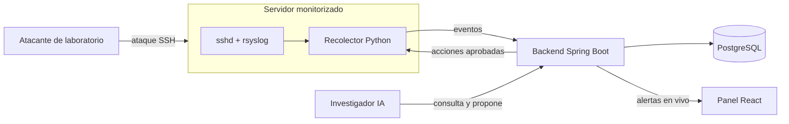

# Vigía · SOC asistido por IA

[](https://github.com/Camilx03/vigia/actions/workflows/ci.yml)

**Vigía** es un SIEM propio que recoge logs de servidores Linux, detecta ataques como fuerza bruta SSH o escaneos de puertos y muestra las alertas en tiempo real. Un agente de IA investiga cada alerta: consulta los logs relacionados, enriquece la IP, resume el incidente y propone una medida de contención que **siempre requiere aprobación humana**.

> **Estado:** en desarrollo. Fase 0 (esqueleto, Docker y CI) completada. Próxima fase: detección de fuerza bruta SSH.

## Arquitectura



## Stack

| Capa | Tecnología |
| --- | --- |
| Backend | Java 21, Spring Boot 4, Spring Data JPA, Flyway, Actuator |
| Base de datos | PostgreSQL 17 |
| Frontend | React, TypeScript, Vite, Tailwind CSS |
| Recolector e IA | Python, SDK de Anthropic (próximas fases) |
| Calidad | JUnit 5, Testcontainers, ESLint |
| Infraestructura | Docker multi-stage, Docker Compose, GitHub Actions |

## Arranque rápido

Requisitos: Docker con Docker Compose. Para el panel en modo desarrollo, Node.js 24.

```bash
git clone https://github.com/Camilx03/vigia.git
cd vigia
cp .env.example .env        # y cambia la contraseña
docker compose up -d --build
```

Comprueba el backend en http://localhost:8080/actuator/health

Panel en modo desarrollo:

```bash
cd frontend
npm install
npm run dev                 # http://localhost:5173
```

## Tests

```bash
cd backend
./mvnw verify               # necesita Docker: Testcontainers levanta un PostgreSQL temporal
```

## Decisiones de diseño

- **Seguridad por defecto:** secretos solo en `.env`, puertos publicados únicamente en `127.0.0.1`, contenedores sin usuario root y Actuator reducido a `health` e `info`.
- **Esquema versionado con Flyway:** Hibernate solo valida (`ddl-auto: validate`) y nunca modifica tablas.
- **Tests contra PostgreSQL real** con Testcontainers, no contra una base de datos en memoria.
- **Sin CORS abierto:** el panel llega al backend a través de un proxy (Vite en desarrollo, Nginx en producción).
- **La IA nunca ejecuta acciones:** solo las propone; un analista las aprueba.

## Hoja de ruta

- [x] Fase 0: esqueleto, Docker Compose y CI
- [ ] Fase 1: detección de fuerza bruta SSH (MVP)
- [ ] Fase 2: login con JWT, alertas en vivo y detección de escaneos
- [ ] Fase 3: investigador IA con aprobación humana
- [ ] Fase 4: despliegue público con ataques reales

## Autor

**Camilo Prado Oropeza**, desarrollador backend Java con especialización en ciberseguridad.

- GitHub: [Camilx03](https://github.com/Camilx03)
- LinkedIn: [Camilo Prado Oropeza](https://www.linkedin.com/in/camilo-prado-oropeza-54b55626a)
